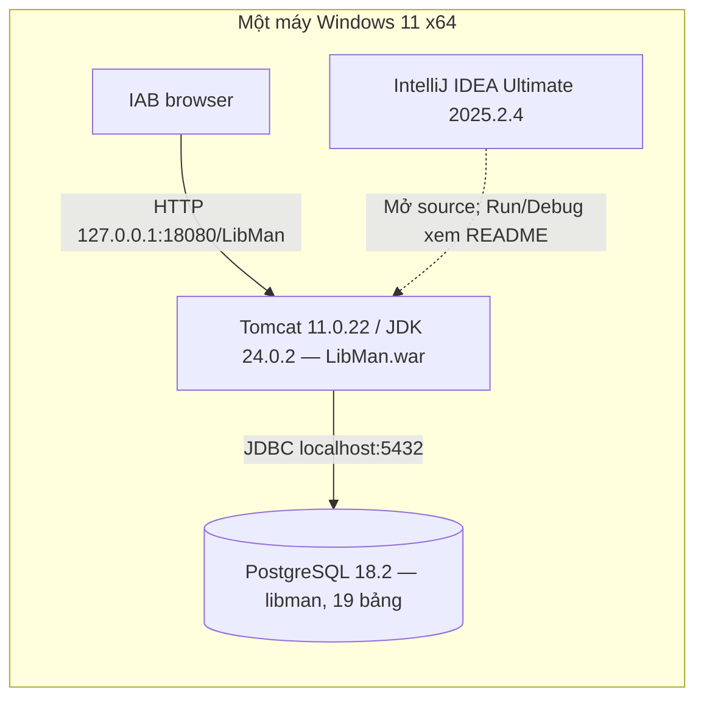

# Triển khai thực tế — 16/11/2026, UTC+7

Một máy Windows 11 x64 chạy browser, Tomcat/JVM và PostgreSQL. Không suy ra nhiều máy hoặc HTTPS từ sơ đồ cũ.

| Thành phần | Giá trị đã xác minh | Bằng chứng |
|---|---|---|
| JVM | Oracle JDK 24.0.2+12-54, C:\Program Files\Java\jdk-24 | java -version; Tomcat ServerInfo |
| Maven | Apache Maven 3.9.15 | mvn.cmd -version; evidence/build.txt |
| Web container | Apache Tomcat 11.0.22, Server number 11.0.22.0 | ServerInfo và startup log |
| CATALINA_HOME | C:\Users\Admin\apache-tomcat-11.0.22 | Runtime được start bằng Bootstrap |
| CATALINA_BASE | C:\Users\Admin\Libman\.local\tomcat | start-demo.ps1; process command line |
| HTTP Connector | address=127.0.0.1, port=18080, protocol=HTTP/1.1 | .local/tomcat/conf/server.xml; HTTP checks PASS |
| URL/context | http://127.0.0.1:18080/LibMan/ ; /LibMan | HTTP 200 và UI browser |
| WAR | target\LibMan.war → .local\tomcat\webapps\LibMan.war | build/startup logs |
| API | Jakarta Servlet 6.1 / JSP do Tomcat 11 cung cấp | web.xml 6.1; 10 JSP được biên dịch/chạy |
| PostgreSQL | Server/client 18.2, x86_64-windows | SELECT version(); psql --version |
| DB | localhost:5432, database libman, 19 bảng | pg_isready, DatabaseSetup1, JDBC checks |
| DB service | postgresql-x64-18 Running | Get-Service ngoài sandbox |
| JDBC | PostgreSQL driver 42.7.10 | pom.xml, runtime integration |
| Secret | .local\db.properties bị ignore; chỉ truyền đường dẫn qua JVM property | Không ghi credential vào nguồn/docs |
| Browser | ChatGPT in-app browser (IAB) | UI và ảnh evidence |
| IDE | IntelliJ IDEA Ultimate 2025.2.4, project Libman | evidence/10-intellij-project.png |
| Múi giờ demo | Asia/Ho_Chi_Minh | JVM option; ngày cấp mẫu 16/11/2026 |

Cổng 8080 của Tomcat cài sẵn được đọc nhưng thử mở socket bị từ chối; không ghi là endpoint chạy thành công. PostgreSQL hiện có listen_addresses='*'; dự án không sửa nó và chỉ kết nối localhost. Tomcat demo chỉ bind loopback. Không setup TLS/HTTPS. Maven/psql chưa ở PATH phiên làm việc kiểm tra; dùng đường dẫn đầy đủ, không sửa PATH toàn máy.

`.local\tomcat\logs\stderr.log` ghi deploy/startup thành công. PID đổi khi restart, đọc `.local\tomcat\process.id`. WAR cuối đã build/deploy và chạy lại kiểm thử. Chưa Run/Debug bằng cấu hình Tomcat của IntelliJ; README phân biệt hướng dẫn với thao tác thực chạy.

Cập nhật sau review 16/11/2026 lúc 19:52 (UTC+7): đã build và deploy lại WAR bỏ cache danh sách phiếu cùng NCC. Endpoint/base/JVM/PostgreSQL không đổi; checksum target/LibMan.war và .local/tomcat/webapps/LibMan.war khớp, log deploy cuối không có SEVERE/Exception. Hồi quy JDBC/constraint/HTTP và test SELECT mới đều PASS; output tại evidence/invoice-list-reload-regression.txt. PID runtime không được hardcode vào tài liệu.

Cập nhật review lần hai 16/11/2026 lúc 20:05 (UTC+7): build/deploy WAR mới với thông báo validation cụ thể và reset ngữ cảnh khi bắt đầu lượt NCC mới. Cấu hình triển khai không đổi; checksum WAR build/deploy khớp và log 0 SEVERE/Exception. Design check, 63 HTTP, 9 reload, 32 JDBC, 6 constraint PASS; output evidence/review2-regression.txt. Không reset database hoặc đổi cơ chế đăng nhập; không Run/Debug IDE trong lần này.

Đồng bộ ERD cuối 16/11/2026: database libman hiện tại đã commit ALTER categoryName SET NOT NULL trên public.tblCategory; trước thay đổi 0 dòng/0 NULL, sau thay đổi is_nullable=NO và varchar(150) qua kết nối mới. Metadata ràng buộc/cột khác/index và fingerprint dữ liệu không đổi. Bằng chứng evidence/category-name-not-null.txt, migration database/migrations/20261116_category_name_not_null.sql. Không sửa Java/JSP hoặc cấu hình runtime, không build/redeploy WAR trong bước DDL này.

